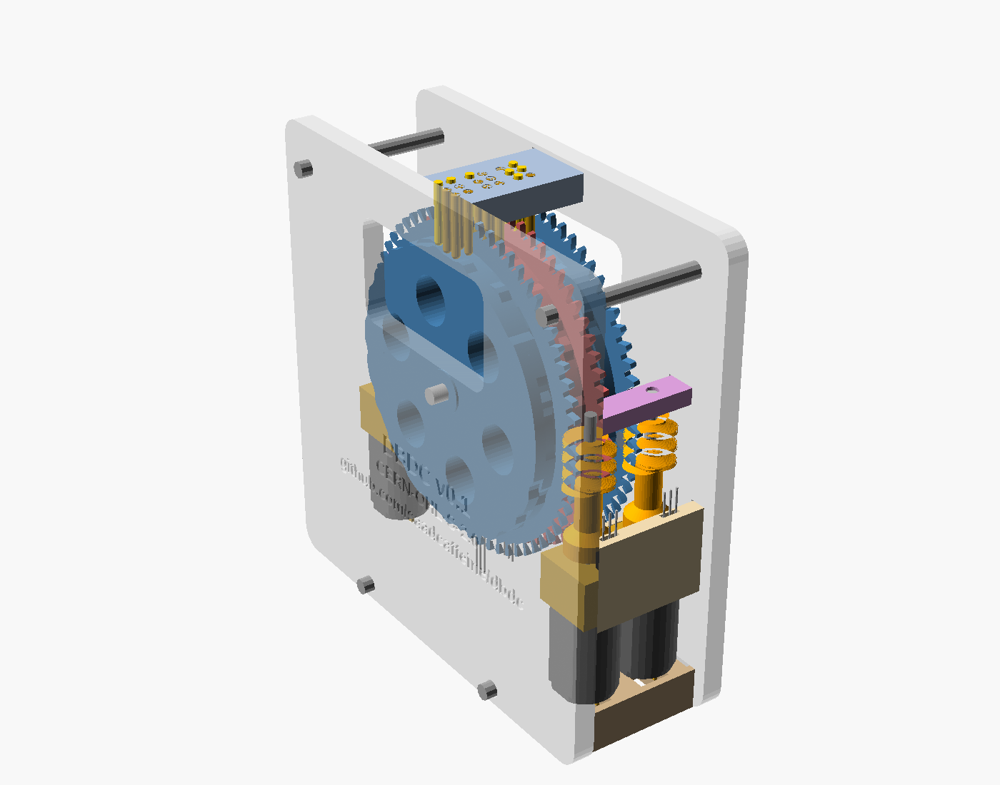
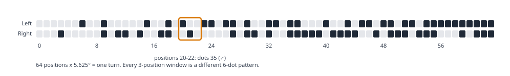

# DBDC Open-Source Refreshable Braille Display

**DBDC (de Bruijn Disc Cell)** is a low-cost, 3D-printable refreshable braille display. Each braille cell is driven by one printed cam disc and one small DC motor, instead of six piezo actuators.



> **Status: v0.2 prototype design.** The 3-cell test unit is fully modelled, collision-checked and exported as print-ready files. It has **not yet been built or tested**. Pin return, an electronics schematic and firmware are still to come. See [Roadmap](#roadmap).

- **Documentation site:** <https://saadcaffeine.github.io/dbdc/>
- **Source:** <https://github.com/saadcaffeine/dbdc>

## Why

Refreshable braille displays let blind people read text from computers, phones and books. They are also some of the most expensive assistive devices around. Conventional displays use one piezoelectric actuator per dot. Commercial cells cost roughly **$100–150 each**, so a 40-cell display costs thousands of dollars. The lowest-cost 20-cell displays still sell for around **$450–$520**. For most of the world's blind people, that puts braille on a screen out of reach. [Why cost matters](docs/why-cost-matters.md) sets out the evidence.

DBDC aims for a display that a makerspace can build from printed parts and commodity components for **a few dollars of parts per cell**. It is open hardware that anyone can repair, adapt and manufacture locally.

## How it works



1. **One disc per cell, two cam tracks.** The left track drives dots 1-2-3 and the right track drives dots 4-5-6. At each of the disc's 64 rim positions, each track is either raised or flat, so each position holds 2 bits.
2. **The pins read three positions at once.** The three pins in each column sit 2.5 mm apart (standard braille dot pitch) and rest on three consecutive rim positions. That gives 3 positions × 2 tracks = 6 dots.
3. **A de Bruijn sequence puts every pattern on the rim exactly once.** The rim carries the de Bruijn sequence B(4,3), a sequence of 64 two-bit symbols in which every run of three appears exactly once. Every one of the 64 six-dot braille patterns therefore sits at exactly one disc position.
4. **The disc size follows from the dot pitch.** Making one 5.625° step move the rim exactly 2.5 mm gives a cam radius of 2.5 / sin(5.625°) = **25.5 mm**, so the disc is **51 mm** across.
5. **Each cell has its own worm drive, and no encoder is needed.** Each disc's wheel has **64 teeth, one per position**, so one turn of the printed worm moves the disc exactly one braille position. The worm sits on a plain **N20 gearmotor**. A tiny magnet in a collar on the worm passes a hall switch once per turn, which gives one pulse per position. A second magnet and hall switch give each disc a home position. The worm can't be driven backwards by the disc, so a reader's finger can't push the dots down and the motor needs no power while idle.

Full explanation: [How it works](docs/how-it-works.md).

## Key numbers (v0.1)

| | |
|---|---|
| Cell pitch / dot pitch | 6.2 mm / 2.5 mm (standard) |
| Positions per disc | 64 (all six-dot patterns) |
| Cam disc / worm wheel diameter | 51.0 mm / 61.9 mm (64 teeth) |
| Drive | Plain N20 DC gearmotor (no encoder), single-start worm, 64:1: one worm turn per position |
| Position sensing | Two hall switches per cell: one index pulse per position, plus home |
| Slowest change (half a turn) | ~3.2 s with an N20 at 600 rpm (32 worm turns); cells move in parallel |
| Power when idle | none (the worm holds the disc) |
| 3-cell prototype size | 88 × 89 × 32 mm |
| Printed parts | 15 parts (9 frame, 3 discs, 3 worms), ~135 g of PLA |
| Estimated parts cost | ~$3–7 per cell, plus ~$10–20 shared (controller, supply, frame) |

Cost figures are estimates from retail and marketplace prices, not quotes. See [`hardware/bom.csv`](hardware/bom.csv).

## Repository layout

```
hardware/
  cad/dbdc_3cell.scad        main OpenSCAD source (parametric, all parts)
  cad/history/               earlier design iterations, kept for reference
  stl/                       print-ready STLs, each laid flat
  bom.csv                    bill of materials with datasheet links
software/
  dbdc_table.py              generates pattern -> position tables, checks the CAD
  generated/                 C header, JSON, Markdown table, SVG diagram
docs/                        GitHub Pages site (Jekyll, just-the-docs theme)
LICENSES/                    full licence texts
```

## Quick start

1. Print the parts in [`hardware/stl/`](hardware/stl/): three `dbdc_disc`, two `dbdc_worm_front`, one `dbdc_worm_back`, and one of everything else. Every part prints flat without supports.
2. Buy the parts in [`hardware/bom.csv`](hardware/bom.csv).
3. Follow the [build guide](docs/build-guide.md).
4. To change the design, open [`hardware/cad/dbdc_3cell.scad`](hardware/cad/dbdc_3cell.scad) in [OpenSCAD](https://openscad.org/). Each part can be exported laid flat for printing, for example:
   ```sh
   openscad -D 'part="print_disc"' -o dbdc_disc.stl hardware/cad/dbdc_3cell.scad
   ```
5. To regenerate the position tables and check them against the CAD:
   ```sh
   python3 software/dbdc_table.py
   python3 software/dbdc_table.py --check-scad hardware/cad/dbdc_3cell.scad
   python3 software/dbdc_table.py --text "hello"
   ```

## Related projects

DBDC builds on a long line of work on low-cost braille: NIST's rotating-wheel display, wheel-based experiments, open-source tools such as BRLTTY and liblouis, and commercial low-cost displays. [Related projects and products](docs/related-projects.md) lists them, with the open-source ones highlighted.

## Roadmap

- [ ] Pin return (foam strip or light springs) and a reading-surface cover
- [ ] Build and test the 3-cell prototype; measure refresh time, noise and dot height
- [ ] Electronics schematic (KiCad) for an ESP32 + DRV8833 controller board
- [ ] Open firmware: homing, index-pulse positioning, USB/serial and BRLTTY driver
- [ ] Tagged v0.1 release and OSHWA certification ([checklist](docs/oshwa-certification.md))
- [ ] 20-cell line with a shared base and a single controller board
- [ ] User testing with braille readers

## Contributing

Contributions are welcome, especially from braille readers, teachers of the visually impaired, and makers who can build and test a unit. See [CONTRIBUTING.md](CONTRIBUTING.md).

## Licence

- Hardware: [CERN-OHL-S-2.0](LICENSES/CERN-OHL-S-2.0.txt)
- Software: [MIT](LICENSES/MIT.txt)
- Documentation: [CC BY-SA 4.0](LICENSES/CC-BY-SA-4.0.txt)

Details are in [LICENSE.md](LICENSE.md). DBDC is **not yet OSHWA certified**; certification is planned once v0.1 is built and released.
