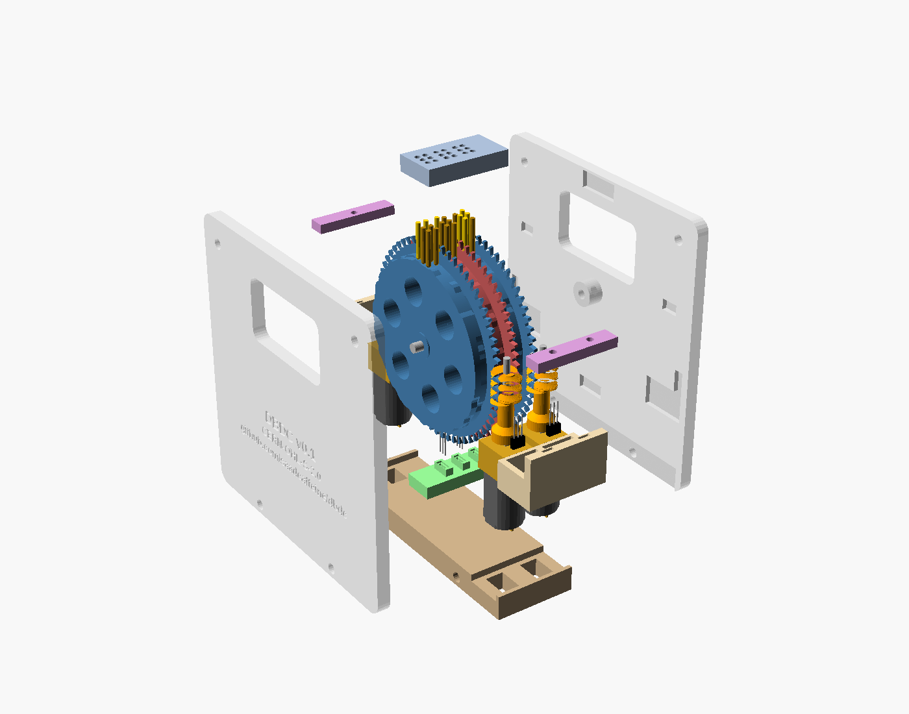

# Build guide: 3-cell prototype v0.2
{: .no_toc }

{: .warning }
> This guide describes a design that has not been built yet. Expect to adjust clearances, and please report what you find so the next version is better.

1. TOC
{:toc}

## Bill of materials

The full list, with datasheet links and price estimates, is in [`hardware/bom.csv`](https://github.com/saadcaffeine/dbdc/blob/main/hardware/bom.csv).

### Printed parts

| Part | Qty | Approx. size (mm) | Print notes |
|---|---|---|---|
| `dbdc_disc` | 3 | 62 × 62 × 6.1 | Wheel face on the bed, 4 perimeters |
| `dbdc_worm_front` | 2 | 8.9 × 8.9 × 21 | For cells 1 and 3. Upright, pinned end on the bed, 0.1–0.15 mm layers |
| `dbdc_worm_back` | 1 | 8.9 × 8.9 × 21 | For cell 2. Same as front, but with the index magnet hole at a different angle |
| `dbdc_panel_left` | 1 | 89 × 88 × 4 | Outer face down (the label prints into the bed side) |
| `dbdc_panel_right` | 1 | 89 × 88 × 9 | Outer face down, axle collar up |
| `dbdc_guide_plate` | 1 | 27 × 14 × 5 | Flat |
| `dbdc_rail_front` | 1 | 27 × 15 × 16 | Flat, tower up |
| `dbdc_rail_back` | 1 | 27 × 15 × 16 | Flat, tower up |
| `dbdc_comb_front` | 1 | 27 × 5 × 3 | Flat |
| `dbdc_comb_back` | 1 | 27 × 5 × 3 | Flat |
| `dbdc_sensor_rail` | 1 | 27 × 10 × 6 | Flat, pedestals up |
| `dbdc_base` | 1 | 27 × 82 × 8 | Flat |

About 135 g of PLA or PETG in total. No part needs supports.

{: .important }
> The front and back worms are **not interchangeable**. Each has its index-magnet hole at the angle that faces its own hall switch when the disc is on a position.

### Bought parts

| Item | Qty | Notes |
|---|---|---|
| N20 gearmotor, **no encoder**, 3 mm D-shaft | 3 | 10 × 12 mm body; any ratio giving roughly 300–1000 rpm at 6 V |
| Hall switch, TO-92 (e.g. TI DRV5023, LPG package) | 6 | Two per cell: index and home. Open-drain, 2.5–38 V |
| Neodymium magnet, 2 mm × 1.5 mm | 3 | Index magnets, in the worm collars |
| Neodymium magnet, 3 mm × 1 mm | 3 | Home magnets, in the wheels |
| Brass rod, 1.5 mm | 300 mm | 18 braille pins |
| Brass or steel rod, 2 mm | 30 mm | Three worm journal pins, 9.5 mm each |
| Steel rod, 3 mm | 30 mm | Axle, cut to 29.1 mm |
| M3 × 40 bolt and nut | 4 | Tie bolts |
| ESP32 development board | 1 | Controller |
| DRV8833 dual H-bridge module | 2 | One channel per cell |
| 5–6 V, 1–2 A supply | 1 | Motor power |
| 10 kΩ resistors | 6 | Pull-ups for the hall switches, if your board's pins have none |

## Prepare the parts

1. **Pins.** Cut twelve pins to **11.25 mm** (front and back rows) and six to **11.13 mm** (middle row). Round and polish one end of each, which rides on the cam. A drill and fine sandpaper work well.
2. **Home magnets.** Press a 3 × 1 mm magnet into the round pocket near the rim of each wheel. Fit them all with the **same pole facing out of the wheel face** (south for a DRV5023 facing it), then glue them with a drop of CA.
3. **Index magnets.** Press a 2 × 1.5 mm magnet into the radial hole in each worm's collar, with the **same pole facing outward** on all three, flush with the collar surface. Glue them.
4. **Worms.** Cut three **9.5 mm** lengths of 2 mm rod and press one into the hole in the free end of each worm, leaving **4.5 mm** standing out. Then push each worm onto a motor's D-shaft: the **front** worms onto two motors, the **back** worm onto the third. It should be tight. If it's loose, add a drop of CA.
5. **Solder leads** to each motor's two tabs, and to each hall switch's three legs, before assembly.
6. **Fit checks.** Pins should slide freely in the guide plate. Motors, worm first, should push up through the rail pockets with light friction. The journal pins should turn freely in the comb holes.

## Assemble



The order matters. The motors go in from below, through the rails, and the base slides in last.

1. **Lay the right panel flat**, pockets up. "Up" and "down" below refer to the unit standing upright.
2. **Thread the drum.** Slide the three discs onto the 3 mm axle. Each disc's small spacer boss faces the left panel, and each wheel faces the right. Lower the axle into the right panel's collar.
3. **Stand these cross parts in their pockets:** the guide plate, both worm combs, both motor rails and the sensor rail. Leave the base out for now.
4. **Fit the hall switches.**
   - **Home switches** stand on the sensor rail's pedestals, branded face towards the wheel they belong to (towards the left end of the unit), with the legs down through the slots.
   - **Index switches** go upside down (legs up) into the pockets in each rail tower, branded face towards the worm. Their legs come out of the top of the tower.
5. **Fit the motors.** Push each motor, worm first, up through its rail pocket. Turn the disc slightly by hand so the worm threads into the wheel teeth. Keep pushing until the gearbox stops against the rail's lip: the journal pin then sits 2.5 mm deep in its comb hole.
6. **Slide in the base** along the axle direction. The motors' end caps run in its two channels, and the motor leads go down through the reliefs.
7. **Close with the left panel** and fit the four M3 × 40 bolts. Tighten them evenly until the panels just clamp the cross parts. Over-tightening bows the panels.
8. **Stand the unit upright and drop in the pins**, longer pins front and back and shorter pins in the middle, rounded ends down.
9. **Check by hand.** Each disc should turn smoothly when you turn its motor shaft. The disc itself should not turn when you push it (the worm holds it), and the worm should not move away from the wheel when you press the disc.

{: .note }
**Pin return is not designed yet.** Gravity alone may drop the light brass pins reliably. If not, lay a thin strip of soft foam over the pin tops under a cover plate, or use a light spring per pin. This is the main open item.

## Electronics and wiring

There is no custom board yet. The suggested prototype uses an **ESP32 development board** and **two DRV8833 dual H-bridge modules**. The pin assignment below is a suggestion only and has not been tested.

| Signal | Cell 1 | Cell 2 | Cell 3 |
|---|---|---|---|
| Motor driver | DRV8833 #1, channel A | DRV8833 #1, channel B | DRV8833 #2, channel A |
| Driver inputs (IN1, IN2) | GPIO 25, 26 | GPIO 27, 14 | GPIO 32, 33 |
| Index switch | GPIO 16 | GPIO 17 | GPIO 18 |
| Home switch | GPIO 19 | GPIO 21 | GPIO 22 |

- **DRV8833 sleep (nSLEEP)** on both modules: GPIO 4 (high = enabled).
- **Motor supply (VM):** 5–6 V. **Hall switches:** 3.3 V from the ESP32 board.
- The DRV5023 output is open-drain and pulls low near a south pole. Enable the ESP32's internal pull-ups on these pins, or fit 10 kΩ pull-ups to 3.3 V.
- Read the index switches with interrupts or the **PCNT** pulse-counter peripheral, so no pulse is missed while other cells move.

### Firmware interface

Firmware has not been written yet. Any firmware needs to:

1. **Home** each cell (see [How it works → Homing](how-it-works.md#homing)).
2. **Convert** the text to braille dot masks, for example with [liblouis](https://liblouis.io/) on the host, and each mask to a disc position with `DBDC_POSITION_OF[]` from [`software/generated/dbdc_positions.h`](https://github.com/saadcaffeine/dbdc/blob/main/software/generated/dbdc_positions.h).
3. **Move** each disc by the shortest signed distance, counting **one index pulse per position**.
4. **Brake** (both H-bridge inputs high) as the target pulse arrives. The flat top of the cam gives about ±72° of worm rotation of tolerance.
5. **Re-home** if an expected index pulse doesn't arrive within a timeout (a stall or a missed pulse).
6. **Disable the drivers** once all cells have arrived (the worms hold position).

## First tests

1. **Turn the discs by hand** and watch the pins rise and fall cleanly through all 64 positions. Look for pins that stick or tilt.
2. **Run each motor slowly in both directions** with a bench supply, and check that the worm engages without skipping.
3. **Sensors.** Turn each motor slowly and watch the index switch: exactly one pulse per worm turn, with the pins at the centre of a position when it fires. Then confirm the home switch is active over a few positions around position 0.
4. **Show "cat".** Move the cells to positions **8, 5 and 49**. Feel for ⠉ ⠁ ⠞.
5. **Record** dot height, firmness, refresh time and noise, and open an issue with your results.

You can print positions for any lowercase text with:

```sh
python3 software/dbdc_table.py --text "hello"
```
