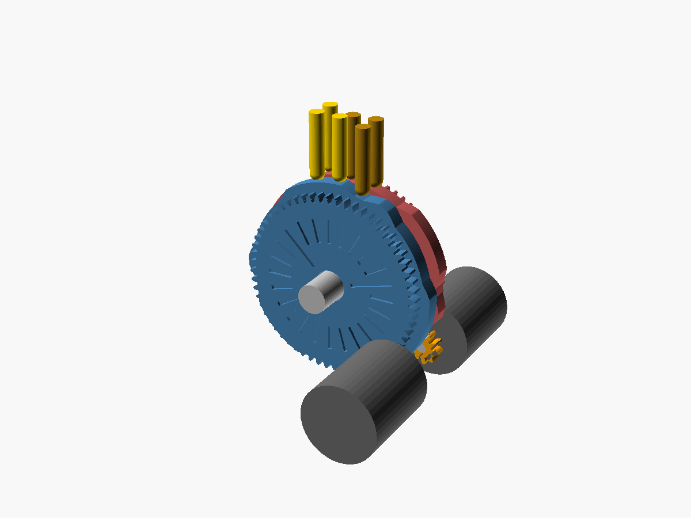
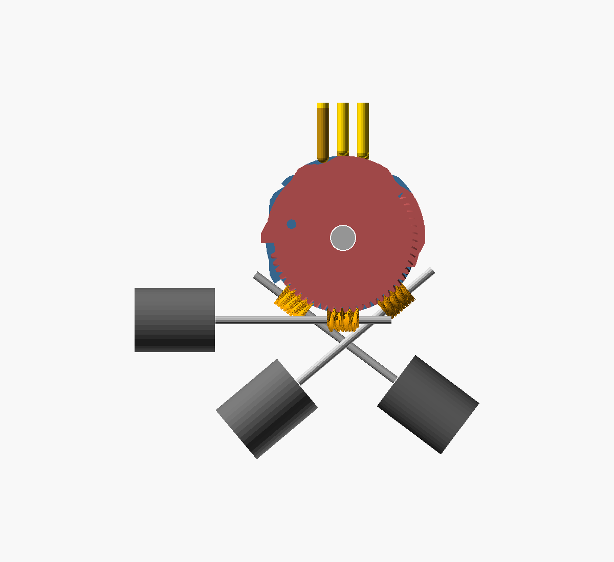
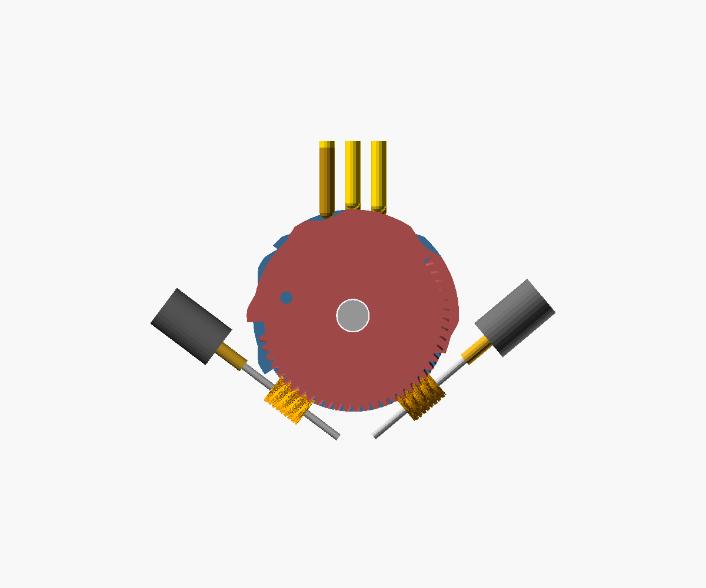
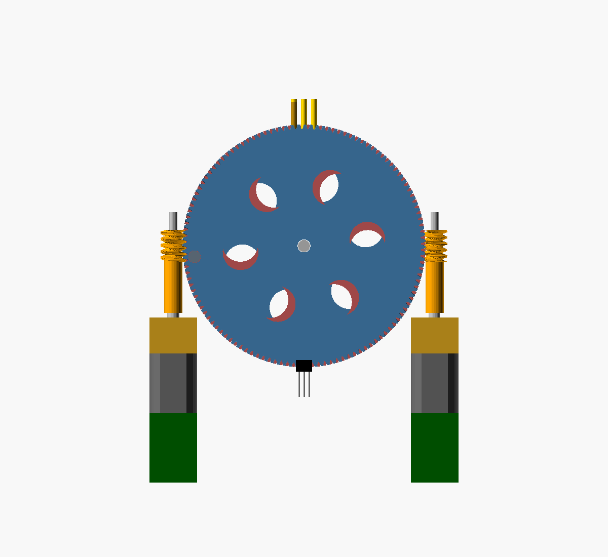
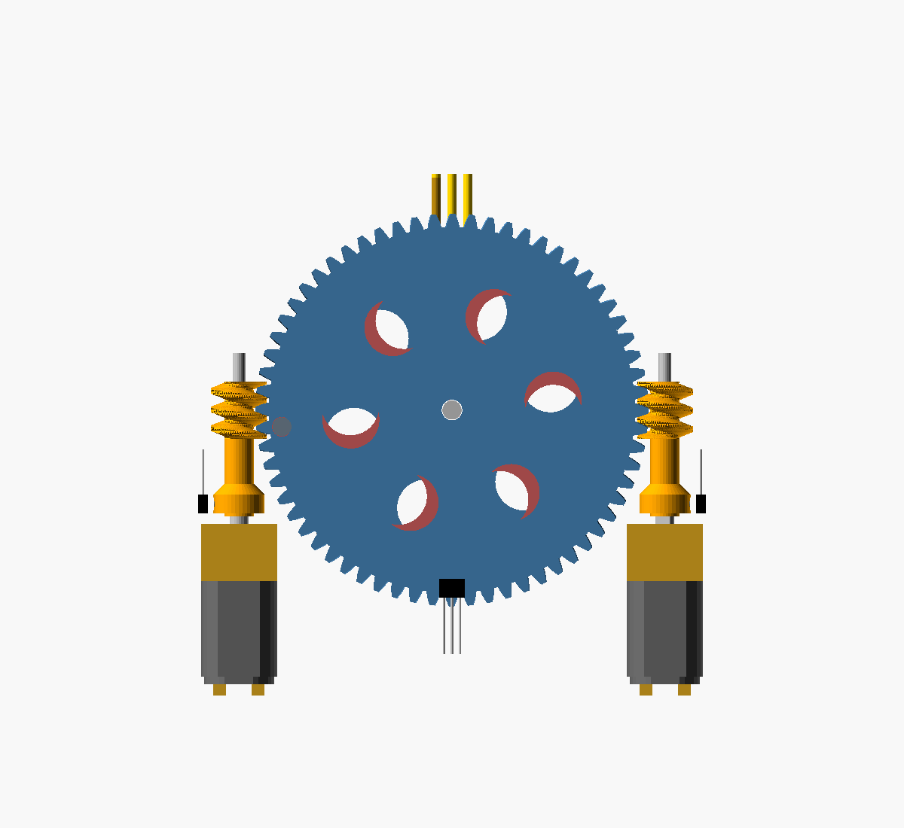

# Design history
{: .no_toc }

DBDC went through five designs. Each earlier file is kept in [`hardware/cad/history/`](https://github.com/saadcaffeine/dbdc/tree/main/hardware/cad/history) so the reasoning stays visible.

1. TOC
{:toc}

## 1. Two discs per cell, stepper on a face gear

The first idea was to drive each **column** (three dots) with its own thin cam disc. The binary de Bruijn sequence B(2,3) = `00010111` has every 3-dot pattern once in 8 positions. Repeated three times around the rim, it gives a **19.3 mm** disc, because R = 2.5 / sin(15°). A small stepper turned each disc through a face gear.

**Why it changed:** a face gear on each disc made the cell wider than the 6.2 mm cell pitch, so cells couldn't sit side by side to form words.

## 2. Two discs per cell, worm drive, 8 mm steppers

A disc only ever needs to turn through one copy of the pattern (105°). That left the bottom of each disc free for **worm-wheel teeth**, so the gear could go on the rim instead of the face. Worms engaged at three different angles, staggered every three discs, so the 8 mm motors fanned out without colliding.

**What it showed:** this works at the standard cell pitch, but needs two motors and two drivers per cell (40 for a 20-cell line), and three staggered positions to fit 8 mm motors.

## 3. Two discs per cell, 4 mm steppers

4.3 mm micro steppers fit in two neat rows, front and back. **The problem is torque.** The estimated need at the motor was ~0.3–0.6 gf·cm, and these motors are unrated, with roughly 1 gf·cm by scaling. That's a thin margin, and it's still two motors per cell.

## 4. One disc per cell, DC motor with encoder

The key step was to give **one disc two tracks** and use the four-symbol de Bruijn sequence B(4,3). That covers all 64 six-dot patterns on one 51 mm disc and **halves the number of motors**. v0.1 drove each disc with an **N20 gearmotor with a hall encoder** through a 120-tooth wheel, which gave a large torque margin, zero holding current and fine resolution.

A first layout put the N20 right next to its worm, and the 12 mm motor body clipped its own wheel. The fix was a printed worm sleeve that holds the motor 18 mm out.

## 5. One worm turn per position, no encoder (current, v0.2)

Encoder N20s cost more, are about 15 mm longer, need six wires each, and give far more resolution than a 64-position disc needs. v0.2 removes the encoder:

- The wheel now has **64 teeth, one per position**, so **one worm turn moves the disc exactly one position**.
- A **2 × 1.5 mm magnet in a collar on the worm sleeve** passes a hall switch in the motor rail once per turn, which gives one pulse per position, centred on the cam's flat top.
- A second hall switch, raised on a pedestal beside each wheel, sees the **home magnet**.
- The motors are plain N20s, and the unit is 14 mm shorter.
- The bigger teeth (module 0.94 instead of 0.5) are also easier to print with a 0.4 mm nozzle.

The cost is two cheap hall switches per cell, and a worm that comes in two versions (front and back), because the index magnet has to face a different way on each side.

## Checks applied to every version

- The worm meshes with the wheel at every position tested, measured as zero overlap volume in OpenSCAD.
- No collisions between discs, worms, motors, sensors, pins, bolts and frame. For the frame, the check uses the full swept volume of each disc, not just one position.
- The pattern-to-position table from the CAD matches the independent Python implementation.
- Every motor and worm can be pushed into place along its full insertion path without touching anything.
- (v0.2) The index magnet faces its hall switch at every position tested, front and back, and faces away halfway between positions.
