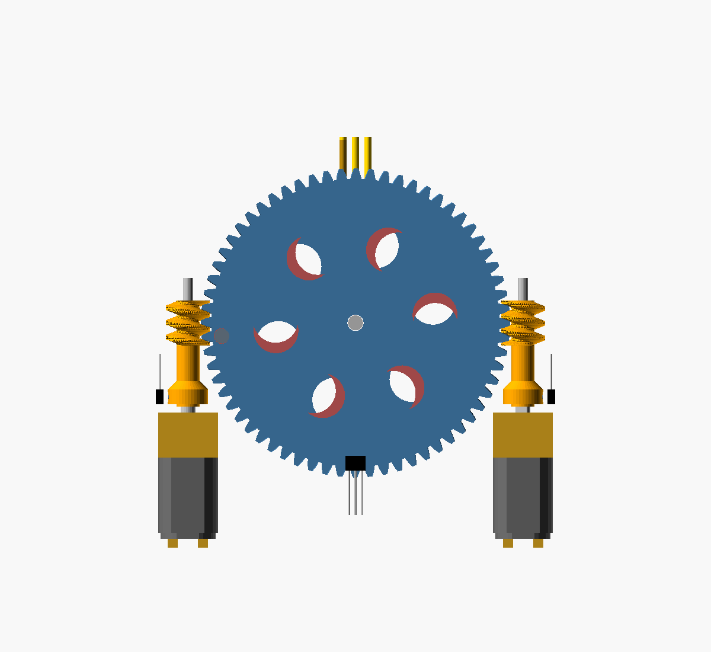
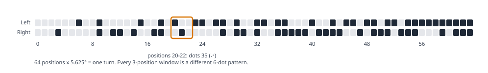
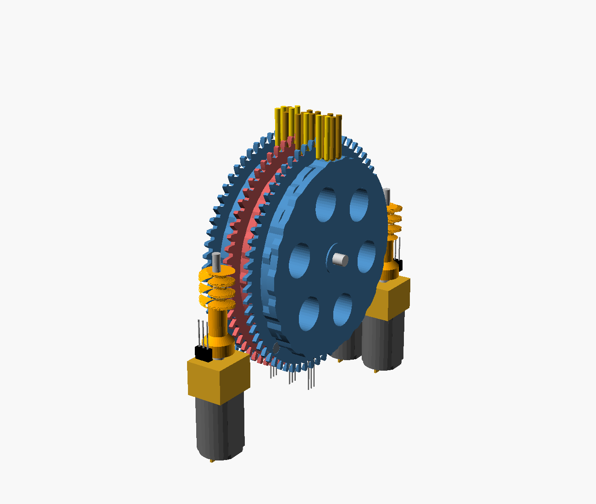
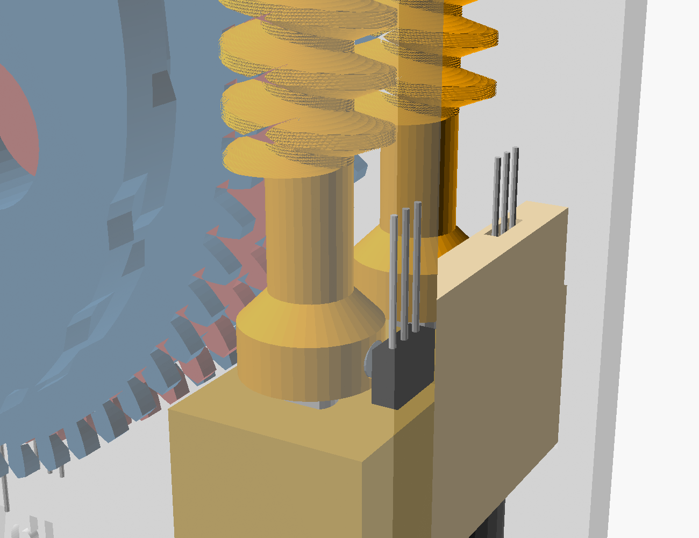

# How it works
{: .no_toc }

1. TOC
{:toc}

## The problem with one actuator per dot

A braille cell has six dots (or eight for computer braille). Conventional refreshable displays give every dot its own piezoelectric actuator, so a 40-cell display needs 240–320 precision actuators. Most of the cost is there.

DBDC uses **one moving part per cell**: a printed cam disc. The disc encodes every possible six-dot pattern around its rim, and a small motor turns it to the pattern you want.

## One disc, two tracks



Each disc is 4.1 mm thick and carries **two cam tracks side by side**:

- the **left track** drives the left column of the cell (dots 1, 2, 3);
- the **right track** drives the right column (dots 4, 5, 6).

The tracks are 2.5 mm apart along the axle, the standard horizontal dot spacing. At each of the 64 positions around the rim, each track is either **high** (dot up, 0.6 mm lift) or **low** (dot down). Each position therefore holds a 2-bit symbol: `2 × left + right`.

## Reading three positions at once

The three pins of a column sit 2.5 mm apart front to back, the standard vertical dot spacing. They rest on three **neighbouring** rim positions:

| Pin row | Dots | Rim position read |
|---|---|---|
| Top | 1 and 4 | `k + 1` |
| Middle | 2 and 5 | `k` |
| Bottom | 3 and 6 | `k − 1` |

So at disc position `k`, the six dots come from a **window of three consecutive symbols**: three positions × two tracks = six bits.

## A sequence with every window exactly once

For this to work, every one of the 64 six-dot patterns must appear as a window somewhere on the rim. A **de Bruijn sequence** B(k, n) is a cyclic sequence over an alphabet of k symbols in which every possible run of length n appears exactly once. With four symbols (two tracks of on/off) and windows of three, B(4,3) has exactly 4³ = **64 positions**, the minimum possible, and contains every pattern once.



DBDC uses the lexicographically smallest B(4,3), generated by the FKM algorithm in [`software/dbdc_table.py`](https://github.com/saadcaffeine/dbdc/blob/main/software/dbdc_table.py). The [position table](position-table.md) lists where every pattern sits.

## Why 51 mm

The pins stand vertically, 2.5 mm apart. For the outer pins to land on the neighbouring positions, one position step must move the rim by the dot pitch at the pin line:

```
R × sin(step) = 2.5 mm,  step = 360° / 64 = 5.625°
R = 2.5 / sin(5.625°) = 25.51 mm   ->  disc diameter 51.0 mm
```

The outer pins touch the rim slightly lower than the middle one, so they are 0.12 mm longer (11.25 mm against 11.13 mm). The CAD model calculates this.

{: .note }
A smaller disc is possible if the pins read every **second** position. A suitable sequence exists and has been checked by computer search, and it gives a disc of about 26 mm. But the cam features become 1.25 mm apart, which is too fine for 1.5 mm round pins and FDM printing. That variant is left for later.

## The cam profile

Each position has a **flat top (dwell)** of 40% of the step, with ramps between. The flat tops mean:

- the dot height doesn't depend on exactly where the motor stops, within about ±0.5 mm of rim travel;
- pressure on a raised pin pushes straight towards the axle and can't turn the disc.

The pins have rounded ends and slide in 1.8 mm holes in a guide plate above the wheels.

## Drive: one worm turn per position



- A **64-tooth worm wheel** (module 0.94, 61.9 mm across) is printed as part of each disc, in the gap between neighbouring cells. Its tooth roots (radius 28.8 mm) sit outside the cam (26.1 mm at most), so the worm never comes near a cam track.
- **64 teeth means 64 positions**, so one turn of the single-start worm moves the disc exactly one braille position. This is what removes the need for an encoder.
- The **printed worm** (8.9 mm across) has a long sleeve that presses onto the 3 mm D-shaft of a **plain N20 gearmotor**. The sleeve holds the 12 mm motor body 18 mm away from the worm so it clears the wheel.
- The worm's **free end is supported** by a 2 mm metal journal pin running in a printed comb bar, so the mesh force can't push the worm away from the wheel.
- Cells alternate between a worm at the **front** and a worm at the **back**, both at axle height, with the motors hanging straight down. Motors on each side are 12.4 mm apart, enough for the 10 mm N20.
- The worm's lead angle is about 7.6°, so the wheel **can't drive the worm backwards**: the disc stays put with the motor off, and pressing on the dots can't move it.

## Sensing position without an encoder



Each cell has two **hall switches** (for example TI DRV5023 in the TO-92 package) and two magnets:

| Sensor | Magnet | What it tells the controller |
|---|---|---|
| **Index** switch, in a tower on the motor rail | 2 × 1.5 mm magnet in a collar on the worm sleeve, pointing outward | One pulse per worm turn = one pulse per position, timed to the middle of the cam's flat top |
| **Home** switch, on a pedestal beside the wheel rim | 3 × 1 mm magnet in the wheel | Which position is position 0 |

The index magnet faces its switch exactly when the disc sits on a position. The model checks this at every position tested, front and back, and checks that the magnet faces away halfway between positions. Each switch's branded face sits within about 1–1.6 mm of its magnet, giving a field many times the switch's threshold.

### Moving to a position

1. Set the motor direction for the shorter way round.
2. Count index pulses: one per position, up or down depending on direction.
3. **Brake as the target pulse arrives.** The cam's flat top is ±0.2 of a position wide, which is ±72° of worm rotation. At 600 rpm, that's a window of about ±20 ms, so a simple brake-on-pulse stop lands in the flat with plenty of margin.

### Speed

The disc turns whichever way is shorter, so the worst case is 32 positions (half a turn), or 32 worm turns:

| N20 output speed | Positions per second | Worst case |
|---|---|---|
| 300 rpm | 5 | ~6.4 s |
| 600 rpm | 10 | ~3.2 s |
| 1000 rpm | ~17 | ~1.9 s |

Any N20 from roughly 300 to 1000 rpm works. The torque needed is tiny, about 3 g·cm at the worm, so choose a speed you're comfortable stopping accurately. Every cell has its own motor, so a whole line refreshes in about the time of its slowest cell, provided the supply can run the motors together. While a disc turns, the pins pass through the patterns in between, so readers should lift their finger during a refresh.

## Homing

At power-up the controller doesn't know where each disc is.

1. Turn the disc in one direction, counting index pulses, until the home switch becomes active. That takes at most one turn of the disc (64 index pulses).
2. Note every index pulse while the home switch stays active. It covers a few positions, symmetric around position 0.
3. **Position 0 is the middle index pulse of that group.**
4. From then on, count index pulses. Re-home occasionally, or if an expected pulse doesn't arrive within a timeout, which suggests a stall.

## Trade-offs

DBDC trades speed and size for cost and simplicity:

- **Slower refresh** than piezo displays: seconds rather than milliseconds. That's fine for reading text a line at a time, not for fast scrolling.
- **Bulkier.** The 3-cell prototype is 88 × 89 × 32 mm, mostly because of the motors hanging below the drum.
- **Some motor noise** during a refresh.
- **Patterns flicker** past the finger while changing.
- **Six-dot only.** An eight-dot version would need B(4,4) = 256 positions or a different scheme.
- **Untested.** Dot feel, firmness and durability need real users to judge.
