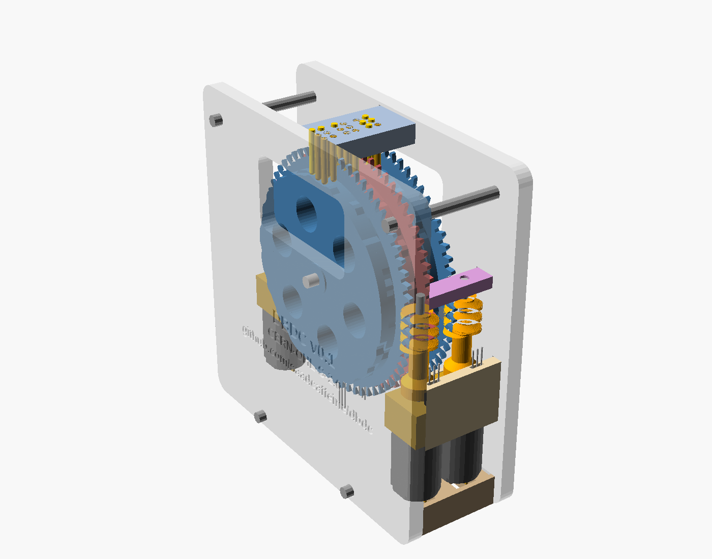

# DBDC Open-Source Refreshable Braille Display
{: .fs-9 }

One printed cam disc and one small motor per braille cell, instead of six piezo actuators. Open hardware, built for makerspaces and affordable for many more readers.
{: .fs-6 .fw-300 }

[How it works](how-it-works.md){: .btn .btn-primary .mr-2 } [Build guide](build-guide.md){: .btn .mr-2 } [Source on GitHub](https://github.com/saadcaffeine/dbdc){: .btn }

{: .warning }
> **v0.2 is a prototype design.** It has been modelled and collision-checked, and the print files are ready, but no unit has been built or tested yet. Pin return, electronics and firmware are still to come. Builders and testers are very welcome.

## The idea in four sentences

1. Each braille cell has **one disc with two cam tracks**: one for dots 1-2-3 and one for dots 4-5-6.
2. The three pins of each column rest on **three neighbouring positions** of the rim, 2.5 mm apart, so one disc position sets all six dots.
3. The rim carries a **de Bruijn sequence**, B(4,3), so all **64 braille patterns appear exactly once** in a single turn of a 51 mm disc.
4. A **worm and a plain N20 gearmotor** turn the disc. The wheel has one tooth per position, so the controller counts one pulse per worm turn from a magnet and hall switch, with no encoder. The worm holds the disc with no power, and a finger can't push the dots down.

## What's here

| Page | What you'll find |
|---|---|
| [How it works](how-it-works.md) | The de Bruijn cam, the geometry, the drive and homing, and the trade-offs |
| [Build guide](build-guide.md) | Bill of materials, printing, assembly, wiring and first tests |
| [Position table](position-table.md) | Disc position for every one of the 64 braille patterns |
| [Design history](design-history.md) | Earlier iterations and why they changed |
| [Related projects and products](related-projects.md) | Open-source projects, research and commercial displays |
| [Why cost matters](why-cost-matters.md) | Prices, braille literacy and employment, and the case for open hardware |
| [OSHWA certification](oshwa-certification.md) | How the project maps to the certification requirements, and what's left |

## Licences

| What | Licence |
|---|---|
| Hardware (CAD, STL, BOM) | [CERN-OHL-S-2.0](https://ohwr.org/cern_ohl_s_v2.txt) |
| Software | [MIT](https://opensource.org/license/mit) |
| Documentation | [CC BY-SA 4.0](https://creativecommons.org/licenses/by-sa/4.0/) |

DBDC is **not yet certified** by the [Open Source Hardware Association](https://certification.oshwa.org/). Certification is planned for the first built and released version.
